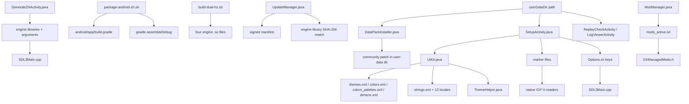

# ARCHITECTURE.md — Generals-Android-Port

Component map, responsibilities, data flow, entry points, lifecycles and coupling.
Every claim is **[FACT]** (read from the tree) or **[INFERENCE]**.

---

## 1. Repository layout and the role of each directory

| Path | Role | Evidence |
|---|---|---|
| `Core/` | Shared engine and platform layer. `GameEngine/`, `GameEngineDevice/`, `Libraries/`, `Main/` | 1 831 `.cpp`/`.h` |
| `Core/GameEngineDevice/Source/` | Device layer: `SDL3Device/`, `SDL3GameEngine.cpp`, `W3DDevice/`, `OpenALAudioDevice/`, `VideoDevice/`, `Win32Device/` | directory listing |
| `Core/Main/SDL3Main.cpp` | Cross-platform entry point (1 485 LOC) | file header |
| `Core/GameEngine/Include/Common/GX*.h` | The port's own engine-side hooks (`GXLogging`, `GXManagedMods`, `GXMouseMode`, `GXRemoteConfig`, `GXSafeArea`, `GXSubtitles`, `GXControlScheme`, `GXCrcStream`) | directory listing |
| `Core/Libraries/Source/d3d8gles/` | D3D8 → GLES 3.0 translation layer + prebuilt ANGLE (`angle-prebuilt/arm64-v8a/{libEGL_angle.so,libGLESv2_angle.so}`) | `CMakeLists.txt` |
| `GeneralsMD/` | Zero Hour game code, builds `z_generals` → `libmain.so` | `GeneralsMD/Code/Main/CMakeLists.txt` |
| `Generals/` | Base game code, builds `g_generals` → `libgenerals.so` | `Generals/Code/Main/CMakeLists.txt` |
| `android/` | The Gradle shell application (the launcher + SDL activity) | 25 Java files |
| `android/app/src/main/java-sdl/`, `jniLibs/` | **Staged, gitignored, generated at packaging time** | `package-android-zh.sh`, `.gitignore` |
| `android/patches/*.patch` | Patches applied to SDL3's vendored Java glue on every packaging run | `sdl-android-gesture-nav-back.patch`, `sdl-android-mouse-source-clicks.patch` |
| `cmake/` | Modular CMake: `dx8.cmake`, `sdl3.cmake`, `openal.cmake`, `adrenotools.cmake`, `triplets/`, `vcpkg-ports/` | directory listing |
| `CMakePresets.json` | Preset definitions, incl. `android-vulkan` | file |
| `scripts/build/android/` | `build-android-zh.sh`, `build-dual-hz.sh`, `build-local-sandboxed.sh`, `package-android-zh.sh`, `publish-apk-gitverse.sh`, `fetch-turnip.sh`, `fetch-vulkan-validation-layer.sh` | directory listing |
| `references/` | 5 git submodules (all currently **uninitialised**) | `.gitmodules`, `git submodule status` |
| `languages/` | 12 language packs × (`generals.str`, `generalszh.str`) + `index.txt` | directory listing |
| `update/` | `config.json`, `features.json`, `support.json` — the content published to the `updates` branch | directory listing |
| `apk/` | The current build + `apk/testers/` (7 builds people are testing) | `apk/testers/README.md` |
| `docs/` | `port/`, `WORKDIR/`, `HOWTO/`, `BUILD/`, `DEV_BLOG/`, `releases/`, `KNOWN_ISSUES/` (deprecated) | directory listing |
| `tools/`, `flatpak/`, `ios/`, `triplets/`, `resources/`, `Dependencies/` | Inherited from the Linux/macOS project; not used by the Android build | see `BUILD_REQUIREMENTS.md` §5 |

---

## 2. The Android application — component map

**[FACT]** 25 Java classes in one package `com.generalsx.zerohour`.

### 2.1 Activities (entry points)

| Class | Manifest flags | Role |
|---|---|---|
| `SetupActivity` | `exported=true`, `LAUNCHER`, theme `Theme.GeneralsZHSettings`, `configChanges=orientation\|screenSize\|keyboardHidden` | The launcher: 5 sections, all settings, folder selection, launch, updates, support |
| `GeneralsZHActivity` | `exported=true`, `MAIN` only, `screenOrientation=landscape`, `launchMode=singleInstance`, `Theme.NoTitleBar.Fullscreen`, `preferMinimalPostProcessing=true` | The game surface, extends `org.libsdl.app.SDLActivity` |
| `FolderPickerActivity` | `exported=false` | Plain `java.io.File` folder browser (deliberately not SAF) |
| `LogViewerActivity` | `exported=false` | crash.log + stderr logs, Copy / Share-as-zip |
| `ModManagerActivity` | `exported=false` | Mod library, import, order, health/analysis |
| `ReplayCheckActivity` | `exported=false` | Run a replay through / watch from a frame, result summary |
| `NetworkDiagnosticsActivity` | `exported=false` | Sweep of the GeneralsOnline endpoints, shareable report |
| `GeneralsOnlineActivity` | `exported=false` | Account sign-in, community data pack, cross-play state |

**[FACT]** All seven launcher activities except `GeneralsZHActivity` call, in this order:
`ThemeHelper.apply(this)` → `super.onCreate` → `ThemeHelper.applyBars(this)` →
`UiKit.appBar` + `UiKit.scrollingPage` → `setContentView` → `InsetUtil.applySafeInsets`.
All seven override `attachBaseContext` to wrap it with `LocaleHelper.wrap`.

### 2.2 Non-activity classes

| Class | LOC | Responsibility |
|---|---|---|
| `UiKit` | 700 | The single source of the launcher's visual language: `dp`, `dim`, `color`, `tint`, `scrollingPage`, `appBar`, `iconButton`, `card`, `sectionHeader`, `body`, `supporting`, `caption`, `helpText`, `divider`, `button` (4 kinds), `buttonRow`, `share`, `segmented`, `switchRow`, `listRow`, `Row`, `chip` |
| `ThemeHelper` | 94 | Palette selection (STANDARD / NAVY / DAY / SYSTEM), colour-name remapping, theme + bar application |
| `LocaleHelper` | 217 | Launcher language, game text token, `languagePackFor`, display names, `Context` wrapping |
| `InsetUtil` | 58 | Adds system-bar and cutout insets to a root view on top of its existing padding |
| `UpdateManager` | 796 | Signed-manifest update: settings, feature switches, support card, engine download + library compatibility + rollback |
| `ModManager` | 639 | Mod library model, ordering, active-list marker, profiles, safe-start counter |
| `ModManagerActivity` | 939 | The Mods screen (UI + analysis orchestration) |
| `ModImportService` | 802 | Transactional import of a folder / `.big` / `.zip` / `.rar`-recognised tree, with bounds and path checks |
| `ModAnalysis` | 411 | Reads a mod's file list, classifies it (gameplay / cosmetic / maps / language, ZH / Generals / both), flags problems |
| `ModHealthCheck` | 148 | Bounded structural scan of an installed mod |
| `ModPacker` | 211 | Renames `.gib` → `.big`, packs loose files into `!!loose_files.big` |
| `ModLibraryInfo` | 64 | Library size |
| `DataPackInstaller` | 738 | GeneralsOnline community data package: manifest, download, install, uninstall, enable/disable, data-mod detection |
| `GeneralsOnlineSession` | 497 | REST auth against `api.playgenerals.online` (+ `api-ru.`), session/refresh tokens, session marker, `refreshSessionAsync` |
| `GeneralsOnlineActivity` | 932 | The account screen |
| `NetworkDiagnostics` | 567 | DNS/TCP/TLS/HTTP probes, device and network facts, synthetic MAC/volume serial, redaction |
| `NetworkTrace` | 191 | The launcher's own rotating network log |
| `SupportLinks` | 370 | Parses the signed `support.json` into blocks/entries/popups |
| `TextEditorBar` | 225 | In-game text entry bar driven by the engine through JNI |
| `ReplayCheckActivity` | 311 | Replay check screen |

---

## 3. Data flow

### 3.1 Launcher start → game running

```
Home icon
  └─ SetupActivity (LAUNCHER)
       attachBaseContext → LocaleHelper.wrap
       onCreate → ThemeHelper.apply → buildUi (try) / buildFallbackUi (catch Throwable)
                → moveOffVulkanOnce → maybeShowSupportPopup
       onResume → reset orientation, refreshStatus, refreshGeneralsOnlineStatus,
                  loadDxvkConfigIntoEditor, refreshDiagnosticsSwitches, refreshUpdatesStatus,
                  once per process: runUpdateCheck(false)
       [Select Game Folder] → FolderPickerActivity → EXTRA_SELECTED_PATH
                            → onActivityResult → isValidGameFolder / findGameFolderIntegrityIssues
                            → saveGamePath → SharedPreferences + external marker file
                                          + writeNativeGameMarker → /data/user/<uid>/…/files/gamedata_path.txt
       [Launch Game] → onLaunchGame → (ModManager.failedStarts ≥ 2 → safe-start dialog)
                     → launchGameNow → applyGameLanguageOverride
                                     → ReplayCheckActivity.clearCheckMarkers
                                     → orientation check → startActivity(GeneralsZHActivity)
                                                          or wait for onConfigurationChanged
  └─ GeneralsZHActivity.onCreate
       setRequestedOrientation(LANDSCAPE)
       extractBundledRuntime()            # assets/gamedata/** → getExternalFilesDir()
       getSavedGamePath() + isValidGameFolder() → else redirect to Setup, never dlopen
       GeneralsOnlineSession.refreshSessionAsync()
       SetupActivity.writeNativeGameMarker()
       SetupActivity.copyBundledRuntimeIfMissing()
       super.onCreate()  → SDLActivity → loadLibraries() → getLibraries()
                                                          → getArguments()
                                                          → SDL_main in libmain.so
  └─ Core/Main/SDL3Main.cpp  (__ANDROID__ bootstrap)
       HOME            = SDL_GetAndroidInternalStoragePath()
       GENERALSX_USERDATA_DIR = /storage/emulated/<uid/100000>/Generals/<leaf>
       GENERALSX_BUNDLED_FONTS_DIR = <external>/fonts
       DXVK_STATE_CACHE_PATH = <cache>
       stderr → <external>/generals-stderr.log   (unless GXLoggingDisabled())
       chdir: gamedata_path.txt → <external>/GameData → <external>
       CNC_GENERALS_PATH        ← generals_base_path.txt     (Zero Hour only)
       GENERALSX_ZH_ART_PATH    ← zerohour_art_path.txt      (Generals only)
       dxvk_validation.txt / dxvk_verbose_log.txt / dxvk_hud.txt / gx_trace.txt / gx_perf.txt …
       DXVK_CONFIG, DXVK_LOG_LEVEL, TryLoadCustomVulkanDriver()
       render backend: d3d8gles_ShouldUseVulkanBackend() / d3d8gles_ShouldUseANGLE()
       → SDL_main → game loop
```

### 3.2 The marker-file interface (Java ↔ native)

**[FACT]** The launcher and the engine never share code; they communicate through small files.
This is the most important interface in the application.

| Marker (writer → reader) | Location | Content | Native reader |
|---|---|---|---|
| `gamedata_path.txt` | app-private `files/` | absolute path | `SDL3Main.cpp` (chdir) |
| `generals_base_path.txt` | app-private `files/` | absolute path | `SDL3Main.cpp` → `CNC_GENERALS_PATH` |
| `zerohour_art_path.txt` | app-private `files/` | absolute path | `SDL3Main.cpp` → `GENERALSX_ZH_ART_PATH` |
| `mods_active.txt` | app-private `files/` | `#profile <name>` + one folder path per line, top priority first | `GXManagedMods.h` |
| `mods_boot_pending` | app-private `files/` | count + the same list | `ModManager.java` + `GXRemoteConfig::markEngineBootComplete` |
| `logging_off` | app-private `files/` | empty | `GXLogging.h` |
| `mouse_mode` | app-private `files/` | cursor percent | `GXMouseMode.h` |
| `control_scheme` | app-private `files/` | `key=1`/`key=0` lines | `GXControlScheme.h` |
| `subtitles` | app-private `files/` | empty | `GXSubtitles.h` |
| `render_backend.cfg` | app-private `files/` | `vulkan` / `gles` / `gles_angle` | `d3d8gles_ShouldUseVulkanBackend()` |
| `custom_driver/` + `custom_driver.cfg` + `custom_driver.auto` | app-private `files/` | driver library name | `TryLoadCustomVulkanDriver()` in `SDL3Main.cpp` |
| `gx_trace.txt`, `gx_perf.txt`, `gx_gles_gputimer.txt`, `gx_audio_trace.txt`, `gx_net_trace.txt`, `gx_touch_debug.txt`, `dxvk_hud.txt`, `dxvk_validation.txt`, `dxvk_verbose_log.txt` | **game data folder** | empty (or HUD element list) | `SDL3Main.cpp` and the engine's GX trace macros |
| `files/update/remote_config.ini` | app-private | `key=value` from the signed manifest | `GXRemoteConfig.h` |
| `files/update/engine_active.txt`, `boot_pending`, `engine_bad.txt` | app-private | integers | `UpdateManager` (Java) + `GeneralsZHActivity` |
| `Options.ini` (`GXUiScale`, `GXUpscale`, `ResolutionFontAdjustment`) | user-data dir | INI | `SDL3Main.cpp` + `GXUiScale.h` |
| `.generalszh_gamepath.txt`, `.generals_gamepath.txt` | shared external storage | absolute path (survives uninstall) | `SetupActivity.readExternalMarker` |
| `generalsonline_session.txt` | app-private | session fields | the native GeneralsOnline client |

**[INFERENCE]** Because the format is implicit, the failure mode of a mistake here is *silent*:
the feature simply does nothing. Every one of these pairs is a place where a future change needs
both sides edited together. `ROADMAP.md` proposes a single documented registry.

### 3.3 Feature-switch and update flow

```
GitHub branch `updates` (or `updates-test`)
  manifest.json + manifest.json.sig      (ECDSA P-256, key in UpdateManager.PUBLIC_KEY_B64)
      │
      ├─ UpdateManager.check(ctx, withEngine)
      │    verify signature → serial must not go down
      │    ├─ config  → files/update/remote_config.ini      (STUN/TURN, pc_exe_crc, datapack url, feature switches)
      │    ├─ support → files/update/support.json           (SHA-256 from the signed manifest)
      │    └─ engine  → files/update/engine/<seq>/libmain*.so
      │                  requires_libs SHA-256 must equal the installed APK's libraries
      │                  seq must exceed assets/engine_build.txt (the commit count)
      │
      ├─ engine reads remote_config.ini via GXRemoteConfig.h
      ├─ engine re-verifies the signature itself for switches other players depend on (GXSignedSettings)
      └─ GeneralsZHActivity.loadLibraries() loads the downloaded engine instead of the APK's
           two failed boots (boot_pending) → engine_bad.txt → back to the APK's engine
```

### 3.4 In-game input and text flow

**[FACT]**

* Touch: SDL3 events → `Core/GameEngineDevice/Source/SDL3GameEngine.cpp` gesture state machine
  (`PENDING` → `PANNING` / `SELECTING` / `PLACING` / `LIST_SCROLL` / UI) →
  `SDL3Device/GameClient/TouchInput.cpp` resolves meaning through
  `pickDrawable` / `screenToTerrain` / `evaluateContextCommand`. No `MSG_RAW_MOUSE_*` synthesis.
* Mouse/touchpad mode: `GXMouseMode.h` marker → pointer path in `SDL3Mouse.cpp`.
* Text entry: the engine calls Java (`showTextEditor` / `hideTextEditor` on `GeneralsZHActivity`)
  → `TextEditorBar` → back through the two JNI natives `nativeTextEditorChanged` /
  `nativeTextEditorDone` → the engine's `AndroidTextEditor.cpp` queues them for its next frame.
* LAN: the engine's `udp.cpp` calls `GeneralsZHActivity.setLanMulticastLock(true/false)` over JNI so
  `WifiManager.MulticastLock` is held only while a LAN socket is open.

---

## 4. Lifecycles, processes and services

**[FACT]**

* **No Android `Service`, no `ContentProvider` except `FileProvider`, no background `BroadcastReceiver`.**
  Everything runs in one process, in activities.
* **Threading model**: no `ExecutorService` except one in `ModManagerActivity`; everywhere else
  `new Thread(...).start()` with `runOnUiThread`/`Handler(Looper.getMainLooper())` for the result.
  Long-running UI work found: update check, data-pack check/install, language-pack download,
  mod analysis, mod import, network sweep, `GeneralsOnlineSession.refreshSessionAsync`.
* **Sign-in lifetime**: `GeneralsOnlineActivity.signInGeneration` is `static` deliberately — the
  sign-in round-trips through a browser, which can bring a new Activity instance, and an instance
  field was already found to leave the abandoned poll loop alive (comment at
  `GeneralsOnlineActivity.java:110–127`).
* **Process-lifetime guards**: `sAutoUpdateCheckedThisProcess` (Setup), `sDataPackCheckedThisProcess`
  (Online), `sTestChannel` (UpdateManager), `languagePackUpdateChecked` (Setup),
  `cachedGpuName` (Setup), `GXLoggingDisabled`'s `static int state` (native).
* **Recreation**: `SetupActivity` saves the open tab (`STATE_TAB`) so the `recreate()` the language
  and theme pickers perform returns to the same section.
* **Game activity**: `singleInstance` + `onNewIntent` so a replay-check relaunch reuses the instance;
  `getArguments()` therefore reads the newest intent.
* **Edge-to-edge**: `targetSdk 35`; every screen pads itself through `InsetUtil`; the game window
  hides the system bars on focus and re-hides them after the notification shade closes.

---

## 5. Coupling map (what a change can disturb)



**[FACT]** Concrete instances of this coupling already causing friction in the tree:

* `SetupActivity.userDataDir()` delegates to `DataPackInstaller.userDataDir()` for Zero Hour and
  hardcodes the Generals leaf itself — so the GeneralsOnline data-pack path is a *dependency of the
  Setup screen*, and `ReplayCheckActivity` and `LogViewerActivity` depend on it too.
* `DataPackInstaller.userDataDir()` hardcodes the Zero Hour leaf
  (`Generals/Command and Conquer Generals Zero Hour Data`), so replays and the community patch are
  always read from the Zero Hour user-data folder even when the base game is selected.
* `SetupActivity` owns `engineLibraries()` and the simulation-rate preference that
  `GeneralsZHActivity.getLibraries()` reads — the launcher decides which `.so` the game loads.

---

## 6. Native/platform isolation

**[FACT]** Per `AGENTS.md` and the code: platform code lives in `Core/GameEngineDevice/` and
`Core/Libraries/Source/Platform/`; game logic does not call platform APIs. The Android-specific
parts of the engine are guarded by `defined(__ANDROID__)` or the shared
`SAGE_MOBILE_PLATFORM` guard (`TARGET_OS_IPHONE || __ANDROID__`), e.g.
`Core/Main/SDL3Main.cpp:42`.

**[FACT]** The engine's own Android hooks are header-only or single-file additions under
`Core/GameEngine/Include/Common/GX*.h` and `Core/GameEngine/Source/.../GX*.cpp`, which is the
pattern a future feature should follow.

---

## 7. Unverified areas

**[FACT]** The following could not be verified from this shallow clone and are stated as open:

* The exact contents of the upstream `claude/network-diagnostics` commit `6cb177c2…` beyond the
  mirrored tree.
* Whether `GeneralsOnlineRelease/` (341 MB) participates in the Android build (no reference to it
  was found in `CMakeLists.txt`, the preset, the packaging script or the workflow — **[INFERENCE]**
  it does not).
* The behaviour of the five `references/` submodules: they are gitlinks only, none is checked out,
  and none is used by the Android build path.
* The `main` branch's own workflows (`GeneralsZH-Android-five-stage-build.yml` and the `*-split`
  variants) were read only structurally; they are not part of `New-UI`.
* Whether the released 1.4.2 APK in `apk/` and the `apk/testers/…-a48.apk` are byte-identical:
  **[FACT]** they are (`md5 a1f65ae3d4423a46e74f8f7bb758958e` for both) — noted because the tester
  README describes `a48` as a separate test build.
